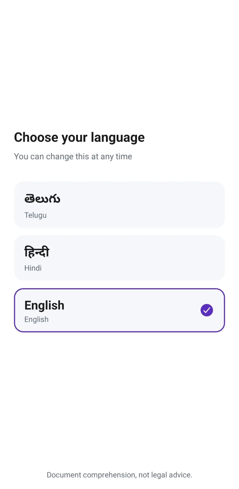
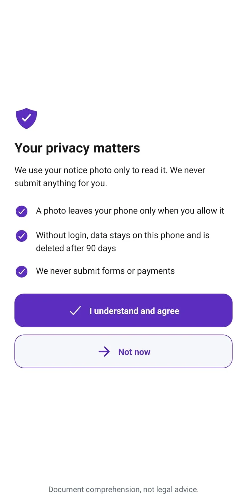
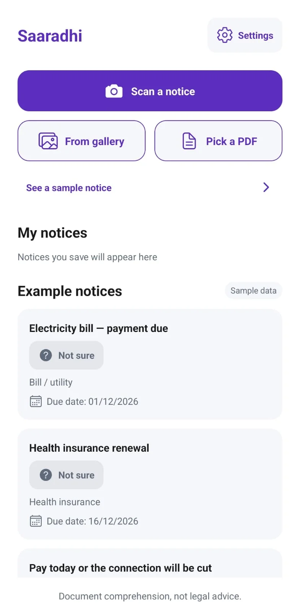
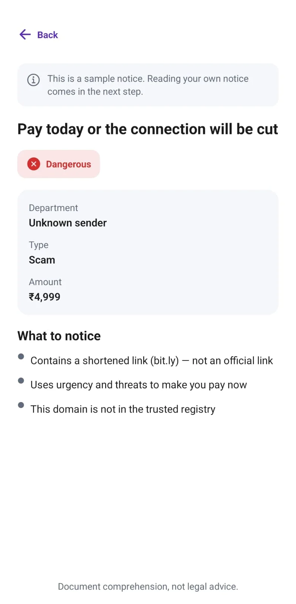
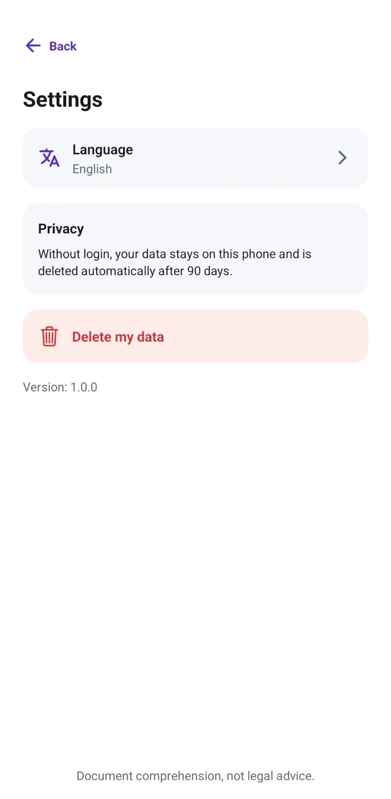
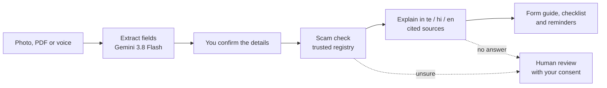
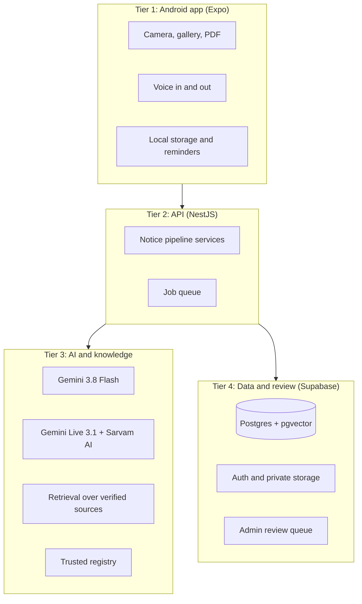

<div align="center">

# Saaradhi (సారథి)

### Your Telugu-first AI guide through notices, forms and scams

*Photograph a notice. Understand it in your language. Know exactly what to fill, what to bring, and whether it is a scam.*

-3DDC84?logo=android&logoColor=white)


</div>

---

## Can't install the app? Start here

You do not need to download anything to understand Saaradhi. This page walks you through the app screen by screen, explains how it works, and shows what is built today.

> **Saaradhi** is Telugu for *charioteer*: the one who guides you safely. That is the whole idea.

### Screen walkthrough

<table>
  <tr>
    <td align="center" width="33%">
      <br/>
      <b>1. Choose your language</b><br/>
      <sub>Telugu, Hindi or English at first launch. Large cards, the selected language ticked, changeable at any time.</sub>
    </td>
    <td align="center" width="33%">
      <br/>
      <b>2. Understand what happens to your photo</b><br/>
      <sub>A photo leaves the phone only with permission, guest data is deleted after 90 days, nothing is ever submitted for you.</sub>
    </td>
    <td align="center" width="33%">
      <br/>
      <b>3. Simple, large-button home</b><br/>
      <sub>One main action: scan a notice. Gallery and PDF sit beside it, with samples to try and a list of saved notices.</sub>
    </td>
  </tr>
  <tr>
    <td align="center" width="33%">
      <br/>
      <b>4. A clear label, with reasons</b><br/>
      <sub>Dangerous, Suspicious, Safe or Not sure, the sender and amount read from the notice, and plain reasons such as a shortened link.</sub>
    </td>
    <td align="center" width="33%">
      <br/>
      <b>5. Language and data in one place</b><br/>
      <sub>Switch language, see exactly where data is kept, and delete everything with a single tap.</sub>
    </td>
    <td></td>
  </tr>
</table>

### What using it looks like

1. **Open Saaradhi** and pick Telugu, Hindi or English.
2. **Take a photo** of a notice, upload a picture, or pick a PDF.
3. **Check the details** Saaradhi read from it (amount, due date, reference number) and fix anything wrong.
4. **See the label:** Safe, Suspicious or Dangerous, with plain reasons.
5. **Listen or read** what the notice means, what happens if you ignore it, and what to do next.
6. **Follow the form guide:** what to write in each field, where to find it, and which documents to attach.
7. **Get reminders** before the deadline, even without internet.
8. **Ask for a person** if Saaradhi is not sure. Nothing is shared until you agree.

---

## The problem

- **Notices are hard to read.** Utility, tax, bank, insurance and welfare notices use dense, formal language. People often cannot tell what is demanded, by when, or what happens if they ignore it.
- **Forms need a helper.** Elderly, low-literacy and first-generation digital users depend on someone else to read and fill in forms, and that person is not always available.
- **Language is a barrier.** Most apps assume English and typing. Many people are comfortable in Telugu or Hindi, and with voice.
- **Scams look official.** Fake bank alerts, bogus government notices and phishing links copy real documents.
- **Chatbots stop at the answer.** They do not verify senders against official sources, remember deadlines, guide form filling, or hand over to a human.

## Our approach

| Principle | What it means |
|---|---|
| **Registry first** | The AI never decides what is "official". A curated registry of official domains, reference formats and helplines does, and every notice is checked against it. |
| **Notice to action** | Not just an explanation: scan, scam check, explanation, form guide, checklist, reminders, human help. |
| **Voice and language first** | Telugu, Hindi and English everywhere, with read-aloud and a planned voice guide. |
| **Prepare only** | Saaradhi never submits a form or a payment for you. |
| **Honest about doubt** | Scam labels come with reasons and are never a guarantee. Unsure cases go to a human reviewer, with your consent. |

## Features

| Feature | Description | Status |
|---|---|---|
| Language selection | Telugu, Hindi, English, changeable anytime | ✅ Working |
| Sign-in and guest mode | No login for basic help; account for follow-ups | ✅ Working |
| Connected database | Supabase connected to the app | ✅ Working |
| Scan and understand | Camera, gallery and PDF input, field extraction with Gemini, confirm-fields screen | 🎨 Designed |
| Plain-language explanation | What it is, what happens if ignored, what to do, with Read Aloud | 🎨 Designed |
| Scam check | Safe / Suspicious / Dangerous with reasons, checked against the trusted registry | 🎨 Designed |
| Form guide | Field-by-field help, document checklist, draft letters (Telugu, Hindi, English), prepare-only | 🎨 Designed |
| Deadlines and reminders | Countdown dashboard and local reminders at 7, 3 and 1 days and on the due day | 🎨 Designed |
| Voice guide | Speak in Telugu or Hindi and the app guides you step by step | 🗺️ Planned |
| Human review | Send a summary to an admin queue, only with consent | 🗺️ Planned |

✅ working in the current prototype · 🎨 screens and specification ready · 🗺️ planned next

## How it works



### Architecture



## Privacy and safety

- **Consent first.** A consent screen explains what is stored before your first upload.
- **Guest data stays on your phone** and is deleted automatically after 90 days.
- **Signed-in data** is kept in the cloud and on the device, protected by row-level security so each user sees only their own records.
- **Human review only with permission.** A case reaches the admin queue only if you agree to send it.
- **Prepare only.** Saaradhi never submits forms or payments.
- **Not legal advice.** Saaradhi helps you understand documents and prepare action. It does not replace a lawyer or an official.
- **Privacy approach** follows the principles of India's Digital Personal Data Protection Act, 2023 (consent, minimisation, deletion).

## Tech stack

| Layer | Technology |
|---|---|
| Mobile app | Expo (React Native), TypeScript |
| Backend API | NestJS |
| Database, auth, storage | Supabase (Postgres, pgvector, Auth, Storage, Row-Level Security) |
| Vision and language AI | Gemini 3.8 Flash |
| Voice AI | Gemini Live 3.1, Sarvam AI (Telugu and Hindi) |
| Reminders | expo-notifications (scheduled on the device) |
| Future channels | WhatsApp, Telegram (via Twilio and bots) |

## Roadmap

- [x] Language selection (Telugu, Hindi, English)
- [x] Sign-in and guest mode
- [x] Supabase connected
- [ ] Scan, extraction and confirm-fields flow
- [ ] Trusted registry and scam labels
- [ ] Cited explanations from a verified knowledge base
- [ ] Form guide, document checklist and draft letters
- [ ] Local deadline reminders
- [ ] Voice-controlled step-by-step guidance in Telugu and Hindi
- [ ] Admin review page
- [ ] WhatsApp and Telegram channels
- [ ] Family guardian alerts (with consent)
- [ ] More Indian languages

## Run it yourself

You need Node.js, the Expo Go app on an Android phone, and a Supabase project.

```bash
git clone https://github.com/aharon-kumar-kosetti/saaradhi.git
cd saaradhi

# install and start the app
cd app
npm install
cp .env.example .env     # add your Supabase URL and anon key
npx expo start           # scan the QR code with Expo Go
```

Environment variables (see `.env.example`; never commit real keys):

```
EXPO_PUBLIC_SUPABASE_URL=
EXPO_PUBLIC_SUPABASE_ANON_KEY=
```

## Repository layout

```
saaradhi/
├── app/         Expo (React Native) Android app
├── api/         NestJS API (pipeline services)
├── supabase/    Database schema and policies
├── data/        Trusted registry, glossary and test notices
├── kb/          Verified source documents for the knowledge base
└── docs/        PRD, design notes and screenshots
```

## Testing approach

Saaradhi is tested against a set of 10 real and 10 fake notices, measuring field-extraction accuracy, scam-label accuracy, time from photo to understanding, and native-speaker review of Telugu and Hindi explanations. The interface has also been shown to elderly users, who found the screens and the Telugu and Hindi text easy to understand. Measured results will be added here as the AI flow comes online.

## Team

Built for **HackWithAditya 2026** (theme: *AI for Bharat*) by students of SRKR Engineering College.

| Role | Name |
|---|---|
| Team Lead | Yirri Bhanu Naga Prakash |
| Member | Katreddi Bhanu Teja Sri |
| Member | Reddy Venkata Saketh |
| Member | Jogi Abishai |
| Member | Guddeti Dathri Sri Sai Anvitha |
| Member | Kosetti Aharon Kumar |

## Disclaimer

Saaradhi provides document comprehension and action preparation only. It is not legal advice, and it never submits forms or payments on your behalf. Scam labels are based on available signals and are not a guarantee. When in doubt, contact the official helpline listed for the department.

---

<div align="center">

**Saaradhi: so no one has to face a notice alone.**

</div>
